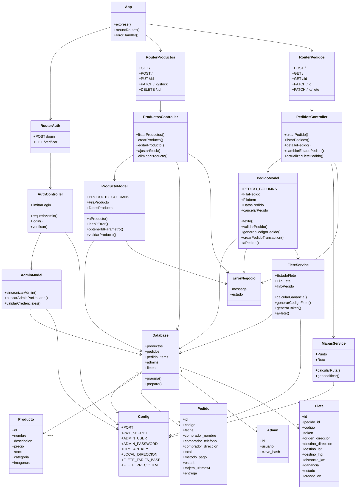

# Diagrama UML del backend Lai-Lai

Este diagrama resume las principales entidades y los módulos que interactúan entre sí en la API del backend.

## Comentario de diseño

- El servidor Express monta tres grupos de rutas principales: autenticación, productos y pedidos.
- Los controladores encapsulan la lógica HTTP y delegan validaciones y persistencia a los modelos.
- Los modelos interactúan con la base SQLite para leer, validar y transformar los datos.
- Los servicios `mapas` y `flete` manejan la geolocalización, cálculo de ruta y datos del envío.
- La clase `ErrorNegocio` centraliza los errores de dominio para devolver respuestas consistentes al cliente.
